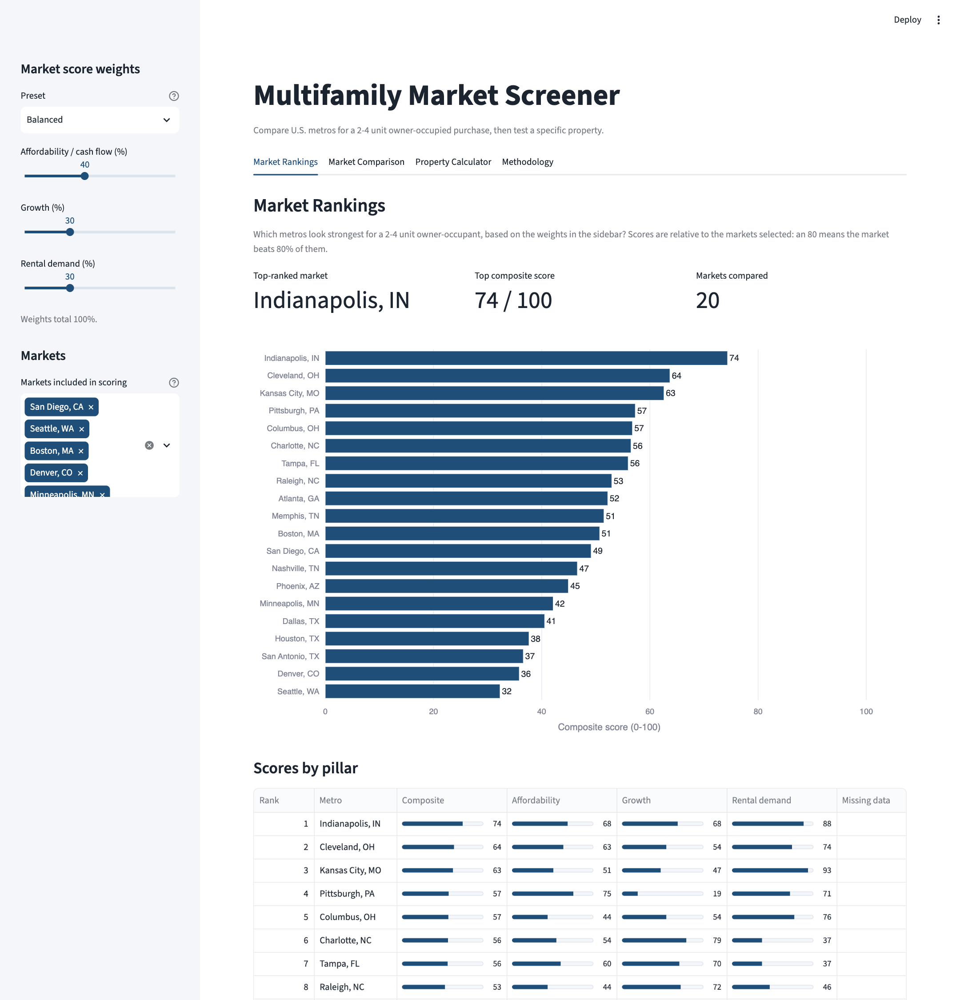
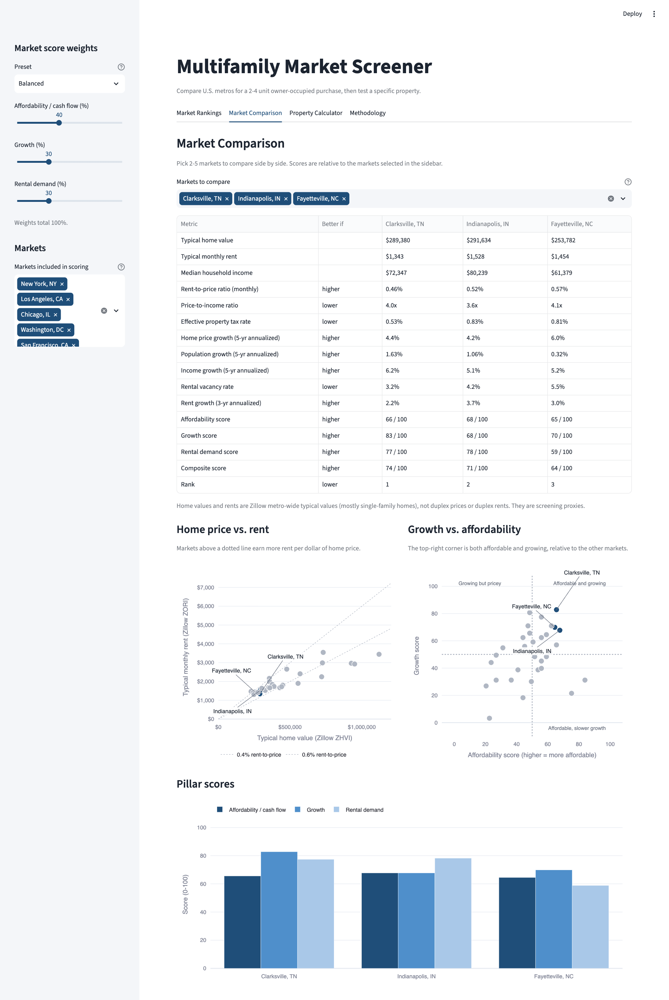
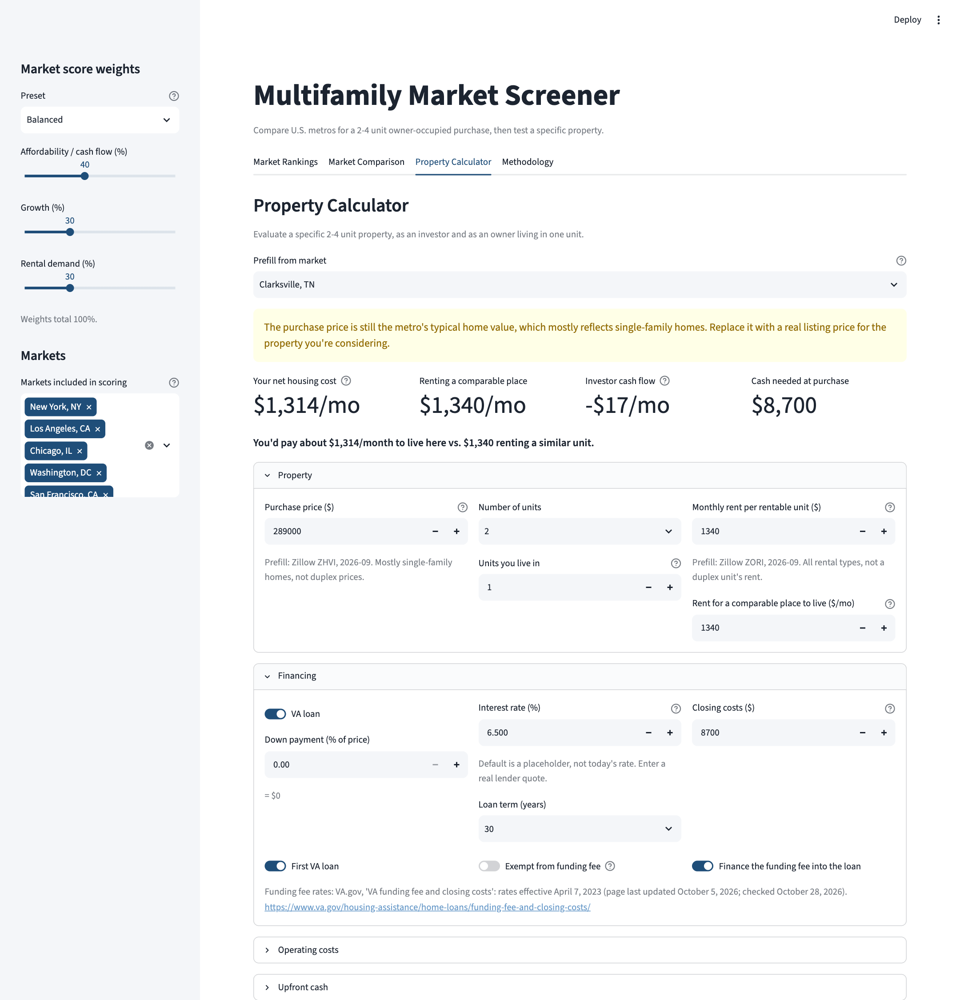
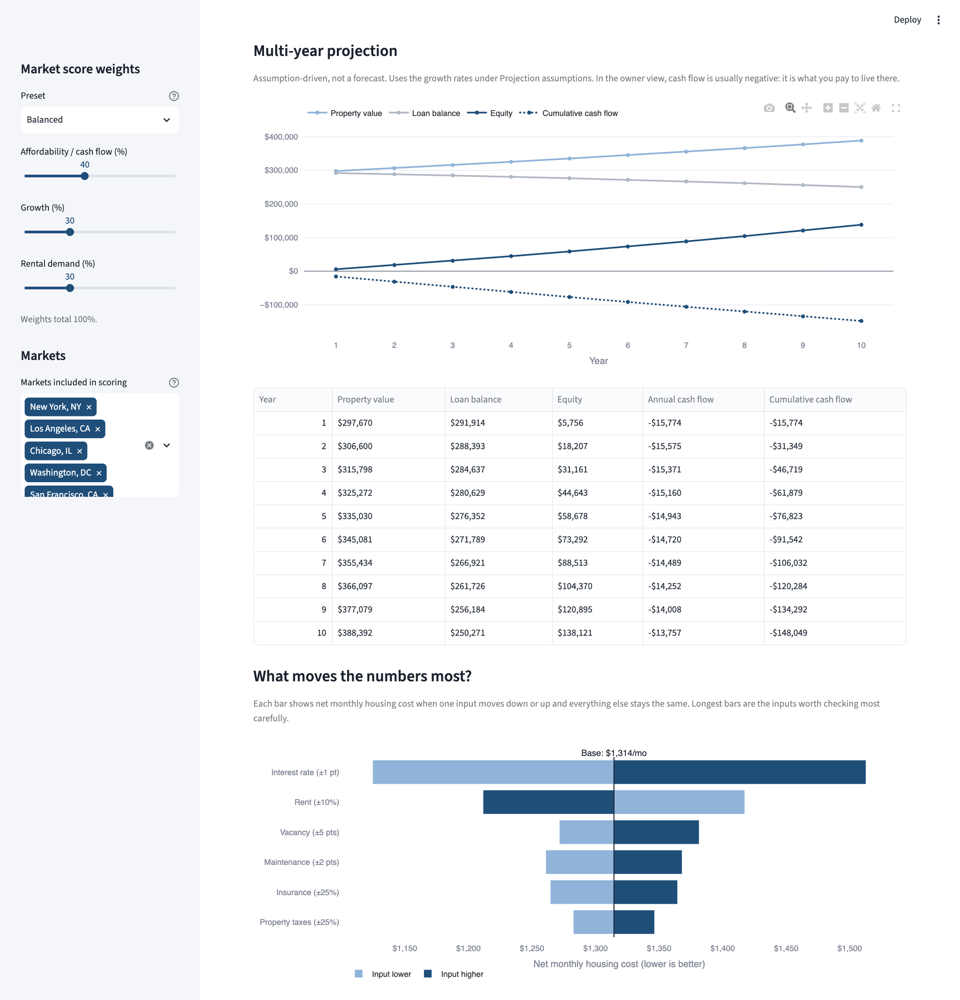
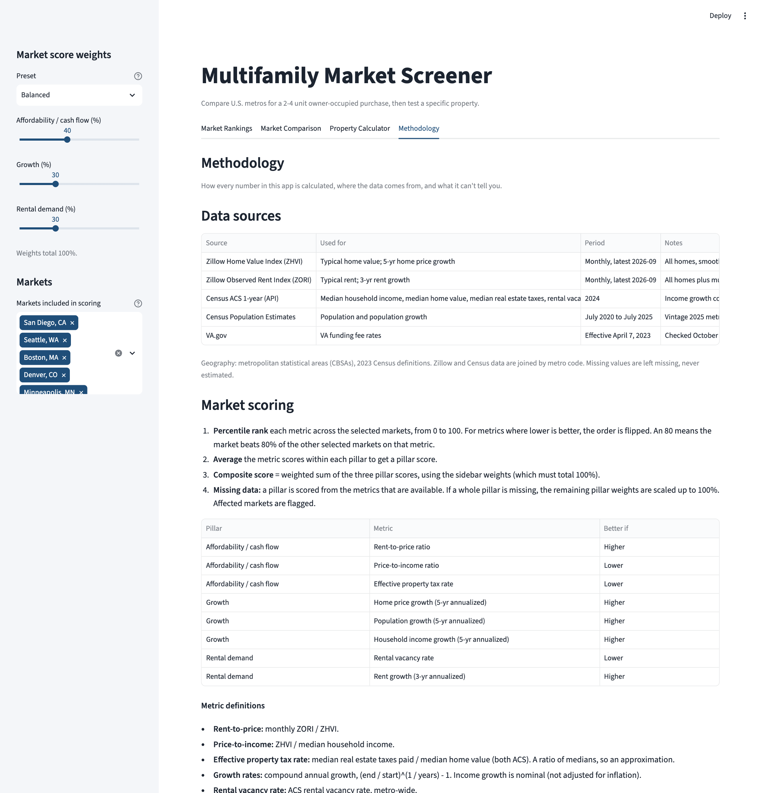

# Multifamily Market Screener

A Python + Streamlit decision tool for buying a small multifamily property (2–4 units) as an
owner-occupant, including with a VA loan.

**Core question:** Which U.S. metros offer the best mix of affordability, growth and rental
demand for a multifamily owner-occupant, and does a specific property make financial sense?

> **Live app:** [multifamily-screener.streamlit.app](https://multifamily-screener.streamlit.app/)



## What it does

| Tab | What you can do |
|---|---|
| **Market Rankings** | Rank 20 metros on a 0–100 score. Adjust the weights of three pillars (affordability, growth, rental demand) or pick a preset, and see how each market's rank changes across presets. |
| **Market Comparison** | Compare 2–5 metros side by side: a metric table, home price vs. rent, growth vs. affordability, and pillar scores. |
| **Property Calculator** | Evaluate one property two ways: as an investor (all units rented) and as an owner living in one unit (house hack). Includes VA funding fee handling, itemized cash needed at purchase, a 5–10 year projection, a sensitivity (tornado) chart, and an optional short-term rental scenario. |
| **Methodology** | Every formula, the scoring method, data sources and years, assumptions and limitations. |

| | |
|---|---|
|  |  |
|  |  |

## What the current data shows

Data: Zillow through September 2026, Census ACS 2024, Census population estimates through July 2025.
Scores are relative to these 20 metros.

- **Indianapolis ranks #1 under all three weight presets** (composite score 74 under Balanced
  weights), with low rental vacancy, solid rent growth and a below-average property tax rate.
- **Weights matter for some markets.** Memphis ranks #4 when weighting cash flow and #15 when
  weighting growth: it has a high rent-to-price ratio but a shrinking population. Pittsburgh shows
  the same pattern (#3 vs. #13).
- **No large metro meets the "1% rule"** at typical prices. Monthly rent-to-price ranges from
  0.31% (Seattle) to 0.64% (Pittsburgh), which is why house hacking (living in one unit) is often
  what makes the numbers work.
- **Example property:** with the calculator's default assumptions (Indianapolis typical value of
  $292,000, a duplex, 0% down VA loan, 6.5% placeholder rate), the owner's net housing cost is
  about $1,278/month vs. $1,530 to rent a similar unit, and about $8,800 of cash is still needed
  at purchase.

These are screening results, not recommendations. See [Limitations](#limitations).

## Methodology in brief

**Market scoring.** Each of 8 metrics is converted to a **percentile rank** (0–100) across the
selected markets, flipped where lower is better. Metric scores are averaged into three pillars, and
the composite is a weighted sum of the pillars.

| Pillar | Default weight | Metrics |
|---|---|---|
| Affordability / cash flow | 40% | Rent-to-price, price-to-income, effective property tax rate |
| Growth | 30% | 5-yr home price growth, 5-yr population growth, 5-yr income growth |
| Rental demand | 30% | Rental vacancy rate, 3-yr rent growth |

Percentile ranks are used instead of min-max scaling because, with only 20 markets, one outlier
would squash everyone else's min-max scores. An 80 simply means "beats 80% of the comparison set."
The trade-off is that scores are relative, not absolute. Presets: Cash-flow focused (60/20/20),
Balanced (40/30/30), Growth focused (20/50/30).

**Property calculator.** Standard real estate formulas: NOI and cap rate exclude debt service;
cash flow subtracts the mortgage; DSCR, break-even occupancy and cash-on-cash return are shown in
the investor view. The owner view never counts the owner's unit as rent. Full formulas are in the
app's Methodology tab and in [`src/calculations.py`](src/calculations.py).

## Data sources

| Source | Data | Period |
|---|---|---|
| Zillow Home Value Index (ZHVI) | Typical home value, home price growth | Monthly, through Sep 2026 |
| Zillow Observed Rent Index (ZORI) | Typical rent, rent growth | Monthly, through Sep 2026 |
| Census ACS 1-year (API) | Income, home value, property taxes, rental vacancy | 2024 (income growth vs. 2019) |
| Census Population Estimates | Population growth | July 2020 – July 2025 |
| VA.gov | VA funding fee rates | Effective April 7, 2023 |

Every column is documented in the [data dictionary](data/data_dictionary.md).

## Run it locally

Requires Python 3.11+.

```bash
git clone https://github.com/noahvo-prj/real-estate-market-screener.git
cd real-estate-market-screener
python3 -m venv .venv
source .venv/bin/activate
pip install -r requirements.txt
streamlit run app.py
```

The processed dataset is included, so the app runs without any downloads. To rebuild it:

1. Download the two Zillow metro CSVs (see the [data dictionary](data/data_dictionary.md)) into `data/raw/`.
2. Get a free [Census API key](https://api.census.gov/data/key_signup.html) and add it to a `.env`
   file: `CENSUS_API_KEY=your_key`
3. Run `python scripts/build_dataset.py`

If the processed dataset is missing or invalid, the app falls back to a clearly labeled demo
dataset of fictional markets.

## Tests

```bash
pytest
```

65 tests cover the finance formulas (including a known mortgage payment, 0% interest, 100% vacancy,
zero rentable units, financed vs. cash VA funding fee), the scoring method (direction, ties,
missing values, weights summing to 100%, outlier robustness), and data loading (demo fallback,
malformed files).

## Project structure

```
app.py                  Page setup and tab routing only
config.py               Default assumptions, metro list, metrics, weight presets, VA fee table
scripts/build_dataset.py  Raw data -> data/processed/markets.csv
src/calculations.py     Finance functions (no Streamlit)
src/scoring.py          Market scoring (no Streamlit)
src/data_loader.py      Load and validate data, demo fallback
src/charts.py           Plotly figure builders
src/ui/                 One module per tab
tests/                  pytest suite
```

Business logic (`calculations.py`, `scoring.py`) never imports Streamlit, so it can be tested on its own.

## Limitations

- **Market metrics are proxies.** ZHVI mostly reflects single-family homes and ZORI covers all
  rental types. Neither is a duplex price or rent. Use the calculator with real listing and rent
  numbers to evaluate an actual deal.
- **Scores are relative** to the markets selected, not an absolute measure of quality.
- **Metro averages hide neighborhood differences** in taxes, insurance, rent and vacancy.
- **Data periods differ:** Zillow is current to the month; Census data lags by about a year. ACS
  margins of error are not shown.
- **Historical growth does not predict future growth.** Projections apply the user's constant
  growth assumptions; they are not forecasts.
- **Lender qualification is not modeled.** Lenders often count only part of projected rent, and
  owner-occupied VA loans are underwritten on debt-to-income ratio, not DSCR.

## Future improvements

- Short-term rental market data, where licensed data is available
- Military installation proximity and BAH-based rental demand
- BLS employment growth
- Insurance cost data, especially flood and storm risk
- Map view
- FHA comparison, including the 3–4 unit self-sufficiency test

---

Analytical screening tool, not financial advice. Historical appreciation does not guarantee future
appreciation. Short-term rental rules vary by city. Taxes, insurance and rents vary and can change.
Loan eligibility and terms vary by borrower and lender.
